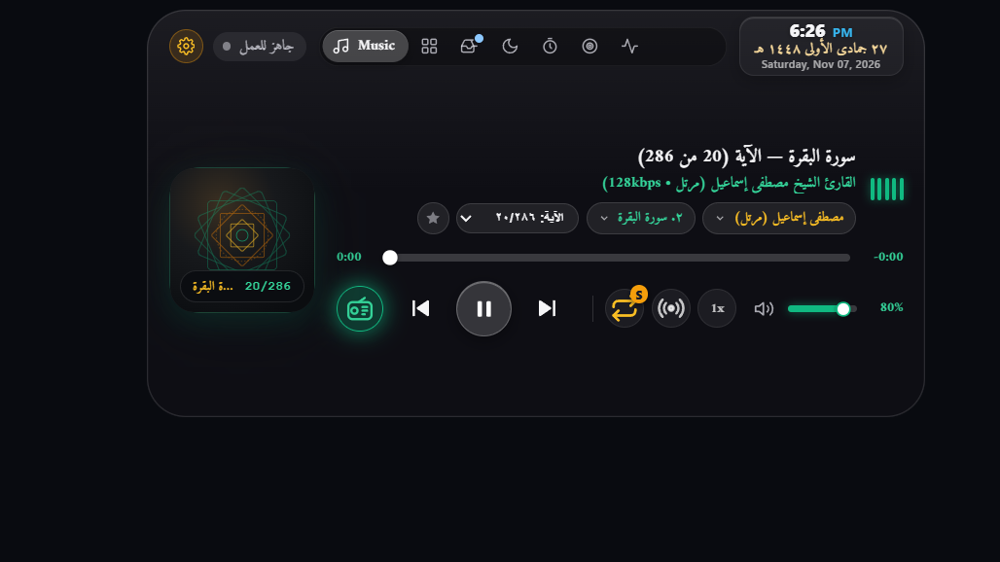
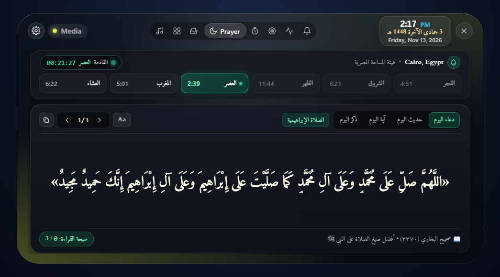
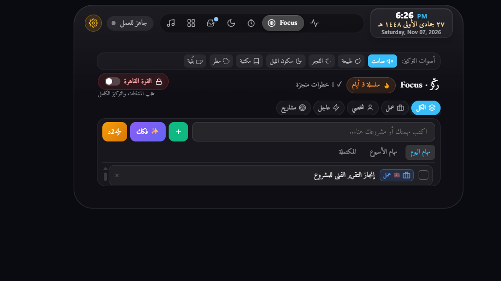
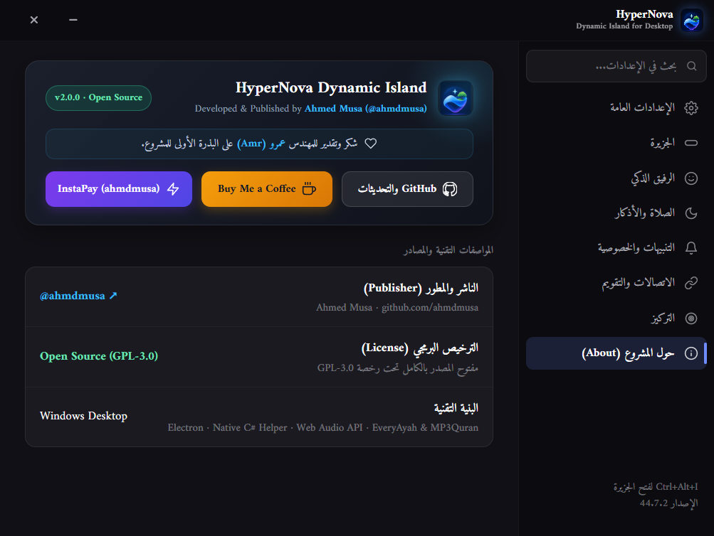
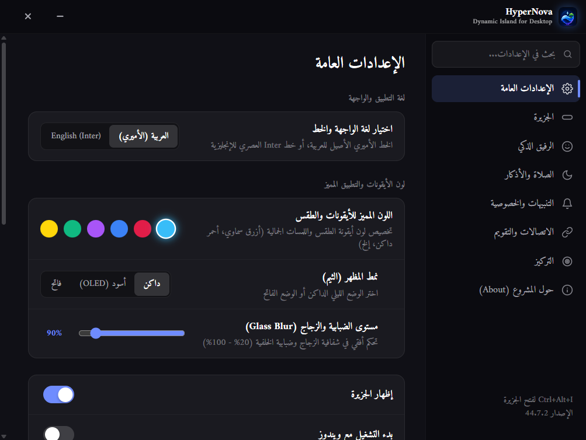

<div align="center">


# بِسْمِ اللَّهِ الرَّحْمَٰنِ الرَّحِيمِ
### «اللَّهُمَّ صَلِّ وَسَلِّمْ وَبَارِكْ عَلَى نَبِيِّنَا مُحَمَّدٍ وَعَلَى آلِهِ وَصَحْبِهِ أَجْمَعِينَ»

<br/>

# HyperNova Dynamic Island
### الجزيرة التفاعلية الفائقة لسطح المكتب • Ambient Dynamic Island for Windows 10 & 11
**هوية إسلامية راقية · خصوصية 100% محلية · تجربة Apple Liquid Glass**

<br/>

**[🇸🇦 النسخة العربية](#-النسخة-العربية--hypernova-dynamic-island)** &nbsp;•&nbsp; **[🇺🇸 English Guide](#-english-guide--hypernova-dynamic-island)** &nbsp;•&nbsp; **[⬇️ التحميل المباشر | Direct Download](#-التحميل-المباشر--direct-download-v213)**

<br/>

<a href="https://github.com/ahmdmusa/HyperNova/releases/download/v2.1.3/HyperNova-Setup-2.1.3.exe">
  
</a>
&nbsp;
<a href="https://github.com/ahmdmusa/HyperNova/releases/download/v2.1.3/HyperNova-Store-2.1.3.appx">
  
</a>

<br/>

[](https://github.com/ahmdmusa/HyperNova/releases/tag/v2.1.3)
[-0078D4?style=for-the-badge&logo=windows)](https://github.com/ahmdmusa/HyperNova)
[](LICENSE)
[](https://developer.apple.com/design/)
[](PRIVACY.md)

<br/>

[-f59e0b?style=for-the-badge&logo=paypal&logoColor=white)](https://www.paypal.com/ncp/payment/4SWPEP8Q3YF78)
[-7c3aed?style=for-the-badge)](https://ipn.eg/S/ahmdmusa/instapay/2yqQQN)

<br/>



</div>

---

## ⬇️ التحميل المباشر | Direct Download (`v2.1.3`)

| الحزمة / Package | الإصدار / Version | النظام / Platform | رابط التحميل المباشر / Direct Download |
|:---|:---:|:---:|:---|
| **المثبّت الرسمي للويندوز** (`NSIS .exe` — موصى به)<br/>Official Windows Installer *(Recommended)* | `v2.1.3` | Windows 10 / 11 (x64) | [**⬇️ تحميل مباشر · Direct Download (`HyperNova-Setup-2.1.3.exe`)**](https://github.com/ahmdmusa/HyperNova/releases/download/v2.1.3/HyperNova-Setup-2.1.3.exe) |
| **حزمة متجر مايكروسوفت** (`Store .appx`)<br/>Windows Store Package *(AppX)* | `v2.1.3` | Windows 10 / 11 (x64) | [**⬇️ تحميل حزمة المتجر · Download AppX (`HyperNova-Store-2.1.3.appx`)**](https://github.com/ahmdmusa/HyperNova/releases/download/v2.1.3/HyperNova-Store-2.1.3.appx) |
| **كافة الإصدارات والملاحظات**<br/>All Releases & Changelogs | Latest | Windows (x64) | [**📦 صفحة الإصدارات · GitHub Releases (`v2.1.3`)**](https://github.com/ahmdmusa/HyperNova/releases) |

---

<div dir="rtl">

## 🇸🇦 النسخة العربية — HyperNova Dynamic Island

**HyperNova** هي جزيرة تفاعلية ذكية (*Dynamic Island*) مصممة خصيصاً لنظامي **Windows 10 و Windows 11**، تجمع بين **الجمال البصري لـ Apple Liquid Glass** و**الهوية الإسلامية الأصيلة** وأدوات الإنتاجية اليومية — بعمل محلي كامل **100%** وبدون أي تتبع أو جمع بيانات.

### أبرز الإمكانيات في الإصدار `v2.1.3`

- **🤖 الرفيق الذكي نوفا (`Living Nova Matrix 2.0`)**:
  - **16 حالة شعورية وفيزيائية حية** (`idle`، `thinking`، `celebrate`، `sleepy`، `khushu`، `petting`، `pre_prayer`، `warrior`، `coffee_break`، `rainy`، `listening_sway`، `welcome`، `meeting`، `surprised`، `breathing`، `deep_sleep`).
  - **4 أزياء تفاعلية تلقائية**: طاقية وسجادة الصلاة قبل الأذان، عصابة المحارب أثناء التركيز، كوب المشروب الساخن للاستراحات، والمظلة مع المطر.
  - استهلاك **0% GPU** في وضع السكون.
- **📿 الهوية الإسلامية الأصيلة والتذكيرات**:
  - تذكيرات دورية محققة بالصلاة على النبي ﷺ (الصلاة الإبراهيمية وصيغ الصلاة المأثورة)، وأذكار الصباح والمساء، وآيات وتدبر بالرسم العثماني مع المسبحة الرقمية.
  - تاريخ هجري ظاهر دائماً بالخط العربي الأصيل (`Amiri`) وبألوان ذهبية متألقة.
- **🕌 مواقيت الصلاة والأذان بالتكبيرتين**:
  - شريط مواقيت صلاة متكامل مع عدّاد تنازلي حي للصلاة القادمة.
  - محرك **الأذان بالتكبيرتين** (بملفات صوتية محلية نقية للشيخ أبي إيفاء السلوم افتراضياً وعيد علي الكلاسيكي) بالإضافة لـ 9 أصوات مؤذنين.
- **📖 إذاعة وتلاوات القرآن الكريم**:
  - مكتبة 114 سورة وبث مباشر مع نخبة القراء (الحصري، المنشاوي، عبد الباسط، مصطفى إسماعيل، الطبلاوي، البنا، السديس، الشريم، المعيقلي).
- **🔔 إشعارات الجزيرة التفاعلية بديلاً لإشعارات ويندوز**:
  - عرض إشعارات التطبيقات (WhatsApp، Telegram، Snipping Tool وغيرها) في كبسولة الجزيرة مع توقف المؤقت عند تمرير الماوس وفتح التطبيق مباشرة بنقرة واحدة.
- **🛠️ ركن الأدوات السريعة والمسجل وبحث `Spotlight`**:
  - مسجل ملاحظات واجتماعات محلي (`MediaRecorder`)، لقطة شاشة فورية للرف، منتقي ألوان، آلة حاسبة رياضية ذكية، وموجه أوامر، مع بحث فوري في التطبيقات عبر `Alt + Space`.
- **🪟 مقاسات متعددة وشفافية زجاجية (0% – 120%)**:
  - التبديل الفوري بين **Compact (`S`: `520×260`)** و**Balanced (`M`: `640×335`)** و**Expanded (`L`: `780×420`)**، ودعم شريط المهام العلوي (`Top Taskbar`) بثلاث وضعيات تموضع.
- **🎯 محرك الإنتاجية (`NeuroFocus`)**:
  - مؤقت بومودورو، قاعدة الدقيقتين ضد التسويف، تقسيم المهام بالذكاء الاصطناعي (BYOK)، وأصوات محيطية مولّدة محلياً بالمتصفح بدون إنترنت.

### خطوات التحميل والتشغيل السريع

1. اضغط على رابط التحميل المباشر أعلاه لتحميل [**HyperNova-Setup-2.1.3.exe**](https://github.com/ahmdmusa/HyperNova/releases/download/v2.1.3/HyperNova-Setup-2.1.3.exe).
2. شغّل المثبّت وأكمل خطوات التثبيت.
3. استخدم الاختصارات العالمية في أي وقت:
   - **`Ctrl + Alt + I`**: فتح / إغلاق الجزيرة.
   - **`Alt + Space`**: فتح البحث السريع عن التطبيقات والأدوات (`Spotlight`).
   - **`Ctrl + Alt + S`**: حفظ لقطة شاشة مباشرة إلى الرف (`Shelf`).
   - **`Ctrl + Alt + F`**: تفعيل / إيقاف وضع التركيز العميق (`Focus Mode`).

</div>

---

## 🇺🇸 English Guide — HyperNova Dynamic Island

HyperNova is an independent, engineered desktop productivity and ambient Dynamic Island experience for **Windows 10 & 11**, crafted with Apple HIG / Liquid Glass aesthetics, rich Islamic features, and **100% local privacy** (zero telemetry).

### Core Capabilities (`v2.1.3`)

* **Living Nova Companion Matrix 2.0**: 16 expressive live emotional states (`idle`, `thinking`, `celebrate`, `sleepy`, `khushu`, `petting`, `pre_prayer`, `warrior`, `coffee_break`, `rainy`, `listening_sway`, `welcome`, `meeting`, `surprised`, `breathing`, `deep_sleep`) with 4 smart contextual outfits and 0% idle GPU footprint.
* **Authentic Islamic Identity & Salawat**: Curated daily reminders enriched with authentic formulas of Salawat on Prophet Muhammad ﷺ (Sahih al-Bukhari / Sahih Muslim verified citations), Adhkar, Hafs Quranic Ayat, permanently Arabic Hijri calligraphy, and integrated Tasbeeh.
* **Precision Prayer & 2-Takbeer Adhan Engine**: Offline Adhan Takbeers (`Abu Ifaa Al-Salloum` short Takbeer default & `Eid Ali` classic Takbeer) plus 9 authentic muezzin voices with smooth volume fading.
* **Interactive Quran Radio**: 114-Surah library and 24/7 live streams from master reciters (Al-Husary, Al-Minshawi, Abdulbasit Abdulsamad, Mustafa Ismail, Al-Tablawi, Al-Banna, Al-Sudais, Al-Shuraim, and Al-Muaiqly).
* **Interactive Clickable Island Notifications**: Route Windows alerts (WhatsApp, Snipping Tool, Telegram, etc.) cleanly into the island with hover-to-pause timers and one-click app activation (`interactive-mode` + `activate-notification`).
* **Quick Tools, Local Recorder & Spotlight Search**: Built-in `Alt + Space` app launcher & safe math evaluator alongside 6 instant tools (Voice/Meeting Recorder, Instant Screenshot to Shelf, Eyedropper, Calculator, Terminal).
* **Multi-Tier Dynamic Island Sizing**: Switch live between **Compact (`S`: `520 × 260 px`)**, **Balanced (`M`: `640 × 335 px`)**, and **Expanded (`L`: `780 × 420 px`)**, plus Floating Pill, Inline 5px Line, and Top Notch display styles.
* **Liquid Glass Continuum (`0% – 120%`) & Top Taskbar Snapping**: Optical blur smoothly transitioning into Solid Dark OLED (`120%`), with Win32 `HWND_TOPMOST` slot snapping over top-docked Windows taskbars.
* **NeuroFocus Productivity Engine**: Pomodoro sessions, 2-minute anti-procrastination rule, BYOK AI task breakdown, and Web Audio synthesized soundscapes.

---

## Visual Showcase | لقطات من التطبيق

<div align="center">

| Quran Radio & Recitations | Prayer Times & Daily Inspirations |
|:---:|:---:|
|  |  |

| NeuroFocus Task Engine | Settings & About |
|:---:|:---:|
|  |  |

| General Settings & Accent Colors |
|:---:|
|  |

</div>

---

## Support & Sponsorship | الدعم والاستمرارية

If HyperNova brings value to your daily desktop workflow, your support helps sustain ongoing development and releases:

* **Buy Me a Coffee (PayPal)**: [https://www.paypal.com/ncp/payment/4SWPEP8Q3YF78](https://www.paypal.com/ncp/payment/4SWPEP8Q3YF78)
* **InstaPay (Egypt)**: [https://ipn.eg/S/ahmdmusa/instapay/2yqQQN](https://ipn.eg/S/ahmdmusa/instapay/2yqQQN)

---

## Building from Source | البناء من الكود المصدري

### Prerequisites
* [Node.js](https://nodejs.org/) (v18.0.0 or higher recommended)
* `npm` package manager
* Windows 10 or Windows 11 development environment (with .NET 4.x `csc.exe` if rebuilding `helper/NovaHelper.cs`)

### Build Commands
```bash
# Clone the repository
git clone https://github.com/ahmdmusa/HyperNova.git
cd HyperNova

# Install dependencies
npm install

# Run in development mode
npm start

# Compile Windows NSIS setup installer (.exe)
npm run dist

# Compile Windows Store package (.appx)
npm run dist:store
```

Compiled packages are placed inside the `dist/` directory.

---

## License & Publisher

* **Publisher & Maintainer**: [Ahmed Musa (@ahmdmusa)](https://github.com/ahmdmusa)
* **License**: Licensed under the [GNU General Public License v3.0 (GPL-3.0)](LICENSE).
* **Privacy & Security**: See [PRIVACY.md](PRIVACY.md) and [SECURITY.md](SECURITY.md).

---

## Open Source Acknowledgement & Upstream Attribution

HyperNova originated as an initial concept and open-source fork of [Nova Island](https://github.com/NOVA-TECH-KIT/nova-island) by AmerTech, before being extensively redesigned, engineered, and expanded for Windows 10 & 11.
